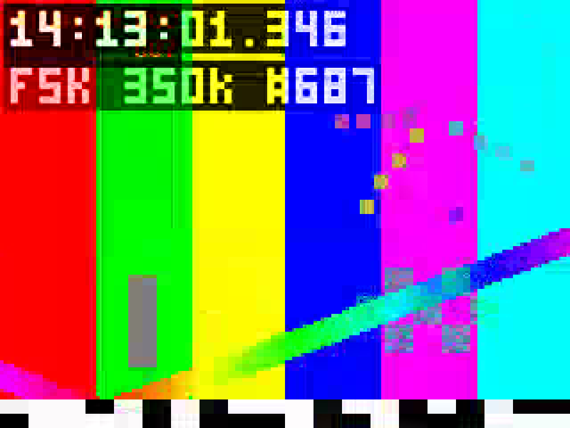

# moq-subghz

DIY MoQ over LoRa. Formerly named moq-lora; the LoRa radio is still the first build. The crates and
binaries keep their `moq-lora-*` names for now.

**DIY MoQ over LoRa: live video from a Raspberry Pi over a LoRa radio chip, written in Rust.**



A Raspberry Pi 2 sends live H.264 video over a common LoRa radio chip to a USB stick on a laptop.
320x240 at 15 fps, about 135 ms glass to glass (capture to screen). It is not LoRaWAN, and it needs no internet,
gateway or server.

```
Pi 2  ──▶  915 MHz FSK radio  ──▶  CatWAN USB stick  ──▶  laptop
```

## Why it's interesting

* **Live video on a LoRa chip.** The SX1276 is slow in LoRa mode, but its plain FSK mode does
  300 kbit/s, enough for a small video stream.
* **Lost frames freeze, they don't smear.** Video is split into MoQ groups (one keyframe interval
  is one group) and objects (one frame is one object). If a frame is lost, the receiver drops the
  rest of that group and waits for the next keyframe.
* **Rust from ffmpeg to the antenna.** The framing, the radio driver and the USB stick firmware
  are all Rust. Frames are encrypted with ChaCha20-Poly1305.

## The MoQ model, from moq.dev

The video framing follows the Media over QUIC model from **[moq.dev](https://moq.dev)**, the open
source MoQ project and its Rust libraries. If you want to build real MoQ streaming over the
internet, start there. moq-subghz borrows the model (groups and objects) and runs its own small Rust
version on a radio instead of QUIC. The radio side does not use moq.dev's code. The optional
republish step does use moq.dev's Rust libraries. This project is not affiliated with or endorsed
by moq.dev.

Want viewers on the internet? `moq-lora-recv --publish` republishes the stream to a moq.dev relay
or moq.pro; see [docs/MOQ.md](docs/MOQ.md).

## Try it (no radio needed)

You need Rust 1.90+ and ffmpeg.

```sh
cargo build --release
./target/release/moq-lora-send --loopback /tmp/air.txt --fec-k 8 --secs 20
./target/release/moq-lora-recv --replay /tmp/air.txt --paced --play --decode --out /tmp/run
```

With real radios, follow **[HOWTO.md](HOWTO.md)**.

## Radio rules

915 MHz is licence-free in the Americas, but **not in Europe and many other places**. The tools
default to 915 MHz at about 3 mW and won't transmit without `--i-have-an-antenna`. You are
responsible for what you transmit. More in the [HOWTO](HOWTO.md#9-radio-rules).

## Learn more

* [docs/DETAILS.md](docs/DETAILS.md): how it works, measured results, repo map and limits
* [HOWTO.md](HOWTO.md): parts, setup and your first live picture
* [Broadcast over MoQ, starting small](https://hikd.ai/posts/broadcast-over-moq/): the idea behind the project
* [CHANGELOG.md](CHANGELOG.md), [ROADMAP.md](ROADMAP.md), [CONTRIBUTING.md](CONTRIBUTING.md), [SECURITY.md](SECURITY.md)

## Credits

* **[moq.dev](https://moq.dev)**: the MoQ model this project follows, and the
  [IETF MoQ working group](https://datatracker.ietf.org/wg/moq/about/) behind the standard.
* **[Rust](https://www.rust-lang.org)**: the whole project.
* **[rind](https://github.com/kixel-ai/rind)**: the pure-Rust encryption library used for the
  ChaCha20-Poly1305 frame encryption.
* Semtech SX1276 radio chip and the Electronic Cats CatWAN USB Stick.

## License

[MIT](LICENSE-MIT) or [Apache 2.0](LICENSE-APACHE), your choice.
