# Old stack vs moq-lora: a side-by-side bench

This demo pushes the same payloads through two paths on one machine and measures both:

* **the old stack**: the usual LoRa/LoRaWAN app path, built here in Python
* **moq-lora**: this repo's wire format, the same Rust code the sender and receiver use

No radios are needed. One command builds, tests and benchmarks both:

```sh
demo/oldstack/run.sh          # or: make -C demo/oldstack demo
```

It takes about four minutes and writes `results/results.md` and `results/results.json`.
`run.sh --quick` is a smoke run of about a minute.

You need Rust 1.90+, Python 3.10+ and Mosquitto (`apt install mosquitto` or
`brew install mosquitto`; or point `MOSQUITTO=` at the binary). Python packages go in a
local `.venv` from `requirements.txt` (paho-mqtt, cryptography, pytest).

## See it

Pictures and a demo built from the measured results (the figures are regenerated from `results/results.json` by `viz/make_figures.py`, so they cannot drift from the numbers):

* [`viz/index.html`](viz/index.html): open it in a browser. It replays the measured 20 second video run frame by frame through both paths, and has a loss slider for a simulation of other loss rates. No server and nothing to download.
* `demo.sh`: a run of about a minute at 5% radio loss that prints a side-by-side table (needs the same tools as `run.sh`).
* The six infographics in [`viz/img/`](viz/img/): [the two paths](viz/img/stack.svg), [frames shown](viz/img/frames-shown.svg), [delay](viz/img/delay.svg), [command round trip](viz/img/command.svg), [channel time (computed)](viz/img/airtime.svg) and [where each wins](viz/img/where-each-wins.svg).



## What moq-lora is (and is not)

moq-lora is a direct sub-GHz radio link: a camera Pi with a Semtech SX1276 sends to a
CatWAN USB stick, which hands the stream to the computer and network behind it. The
SX1276 is the common LoRa chip, but moq-lora runs it in its **FSK mode at 300 kbit/s**,
not LoRa modulation. Video is framed the way Media over QUIC (MoQ, an IETF draft) frames
it: one GOP is a group, one frame is an object. There is no QUIC and no relay here, just
the object model on a raw radio link. Objects can be sealed with ChaCha20-Poly1305 from
[rind](https://github.com/kixel-ai/rind), and this demo turns that on. Everything between ffmpeg and the antenna is
Rust.

It is **not LoRaWAN**. There is no gateway, network server or join procedure.

## The old stack

When people move data over LoRa today, it usually goes like this:

```
 device ─▶ ))) LoRa ))) ─▶ gateway ─▶ network server ─▶ MQTT broker ─▶ your app
 (LoRaWAN   US915 DR4      (Semtech UDP  (ChirpStack,    (Mosquitto)    (Python,
  frames)   SF8/500 kHz     packet        The Things                     paho-mqtt)
                            forwarder)    Stack)
```

This demo builds each piece the same way, small enough to read:

| piece | file | what it does |
|---|---|---|
| device | `oldstack/device.py` | LoRaWAN 1.0.x unconfirmed uplinks: AES-128 payload encryption, AES-CMAC MIC, 16-bit frame counter. Payloads over 242 bytes (the US915 DR4 limit) are cut into fragments with a 4-byte app header, because LoRaWAN has no uplink fragmentation of its own. |
| gateway | `oldstack/gateway.py` | the Semtech UDP packet forwarder protocol: PUSH_DATA with JSON and base64 per frame, PULL_DATA keepalive, PULL_RESP downlinks sent at the requested concentrator time |
| network server | `oldstack/netserver.py` | checks the MIC and frame counter, decrypts, publishes JSON on MQTT in the style of ChirpStack v4; queues downlink commands for the device's next RX1 window (Class A) |
| broker | Mosquitto | the real one, QoS 0 |
| app | `oldstack/app.py` | paho-mqtt subscriber: decodes base64, reassembles fragments, sends commands |

The LoRaWAN code is checked against a public test frame from the lora-packet project.

## What moq-lora changes

* **No network-server hop chain.** Frames go from the radio straight to the receiver,
  which puts objects back together. The old stack wraps every radio frame in JSON and
  base64 twice (gateway to server, server to app) and crosses three processes.
* **Frames sized for media.** Up to 255 bytes per frame and an object can span up to
  255 frames, with XOR parity (one repair frame per 8) so a single lost frame costs
  nothing. LoRaWAN carries at most 242 bytes per uplink and has no FEC across frames.
* **Loss is handled the media way.** A frame of video that can't be repaired drops the
  rest of its group, so the decoder gets clean reference chains and a short freeze
  instead of a smear.
* **No receive windows.** A LoRaWAN Class A device can only hear a command one second
  after it sends an uplink, so a command waits for the next uplink. moq-lora has no MAC
  layer; a command is just an object on the reverse link.
* **A much faster radio mode.** FSK at 300 kbit/s moves a 255-byte frame in about 7 ms.
  LoRa at US915 DR4 (its fastest uplink rate) needs about 177 ms.

## Results

Measured 2026-11-19 on one machine (Intel(R) Xeon(R) Processor, 8 cores, Python 3.13.5, mosquitto 2.0.21). Software path only: the radio is replaced by localhost UDP. Airtime columns are computed, not measured.

### Paced runs (payloads sent on their schedule)

| workload | air loss | stack | delivered | decodable (GOP rule) | latency p50 / p95 / p99 ms | air bytes per payload | backhaul bytes per payload | CPU ms per payload |
|---|---|---|---|---|---|---|---|---|
| sensor | 0% | old stack (Python) | 100.0% | n/a | 1.07 / 1.68 / 2.44 | 25 | 651 | 1.86 |
| sensor | 0% | moq-lora (Rust) | 100.0% | n/a | 0.16 / 0.23 / 0.27 | 192 | 0 | 0.10 |
| sensor | 1% | old stack (Python) | 99.0% | n/a | 1.19 / 1.61 / 2.24 | 25 | 645 | 1.93 |
| sensor | 1% | moq-lora (Rust) | 100.0% | n/a | 0.16 / 0.21 / 0.25 | 192 | 0 | 0.10 |
| video | 0% | old stack (Python) | 100.0% | 100.0% | 43.72 / 49.87 / 89.06 | 1621 | 8310 | 4.83 |
| video | 0% | moq-lora (Rust) | 100.0% | 100.0% | 0.19 / 0.27 / 0.36 | 1892 | 0 | 0.15 |
| video | 1% | old stack (Python) | 94.3% | 69.0% | 43.17 / 49.69 / 90.96 | 1621 | 8234 | 4.79 |
| video | 1% | moq-lora (Rust) | 99.7% | 96.0% | 0.18 / 0.29 / 0.36 | 1892 | 0 | 0.16 |

### Unpaced runs (as fast as the software goes, no loss)

| workload | stack | delivered | payloads/s | goodput kbit/s | latency p50 / p99 ms |
|---|---|---|---|---|---|
| sensor | old stack (Python) | 85.0% | 4222 | 405 | 22.8 / 74.8 |
| sensor | moq-lora (Rust) | 100.0% | 174972 | 16797 | 0.0 / 0.1 |
| video | old stack (Python) | 62.7% | 805 | 9685 | 51.2 / 61.3 |
| video | moq-lora (Rust) | 100.0% | 60521 | 728501 | 0.0 / 0.2 |

### Time on air (model, lossless)

| workload | stack | radio | frames | airtime per payload ms | channel busy at the offered rate | time to send it all |
|---|---|---|---|---|---|---|
| sensor | old stack | LoRa SF8/500 kHz CR4/5, 8-symbol preamble (US915 DR4) | 400 | 28.29 | 57% | 811 s for 20 s of traffic (Class A receive windows) |
| sensor | moq-lora | FSK 300 kbit/s, 6-byte preamble, 2-byte sync, CRC-16 | 800 | 5.71 | 11% | 20 s (keeps up) |
| video | old stack | LoRa SF8/500 kHz CR4/5, 8-symbol preamble (US915 DR4) | 2045 | 1128.58 | 1693% | 4429 s for 20 s of traffic (Class A receive windows) |
| video | moq-lora | FSK 300 kbit/s, 6-byte preamble, 2-byte sync, CRC-16 | 2395 | 52.80 | 79% | 20 s (keeps up) |

### Command round trip (app to device and back, 10 and 10 commands)

| stack | p50 ms | p95 ms | max ms | timeouts | airtime to add on a real radio ms |
|---|---|---|---|---|---|
| old stack, Class A, uplink every 2 s | 1936.6 | 2699.5 | 2699.5 | 0 | 37.3 |
| moq-lora | 0.27 | 152.87 | 152.87 | 0 | 4.1 |

How to read this:

* **Video only fits on moq-lora.** 20 seconds of 180 kbit/s video needs about 17 times
  the airtime one LoRa DR4 channel has, and a single Class A device that waits out its
  receive windows would need over an hour to send it. On the FSK link it uses 79% of the
  channel and keeps up.
* **Under 1% frame loss**, the old stack lost 5.7% of video frames (each frame is about
  seven uplinks with no repair) and only 69% were decodable by the GOP rule. moq-lora
  repaired every single loss its parity could cover: 99.7% delivered, 96% decodable.
* **Commands:** with an uplink every 2 seconds, the old stack's command round trip was
  about 1.9 s median. It scales with the uplink interval, and real sensors often report
  every few minutes. moq-lora answered in well under a millisecond. Its one slow
  sample (153 ms) is the first command of the run: the receiver releases a lone first
  frame after 150 ms idle, the same rule `moq-lora-recv` uses.
* **Small sensor readings are LoRaWAN's home ground.** It used 25 bytes on air per
  12-byte reading. moq-lora used 192, because its defaults are tuned for video: a 17-byte
  object header (frame number, capture time), a 20-byte AEAD tag, a parity frame per
  object and padding to 96 bytes. With FEC and padding off it would be 61 bytes per
  reading, still more than LoRaWAN.
* **Under overload the old stack drops silently.** In the unpaced runs the Python network
  server's UDP socket overflowed; the Semtech UDP protocol has no retransmission, so 15%
  of sensor uplinks and 37% of video payloads never reached the app.

## Is this fair?

What is the same: one machine, one run, the same payload file byte for byte, the same
loss rate drawn from the same generator, encryption on in both (AES-128 in LoRaWAN,
ChaCha20-Poly1305 in moq-lora), and the same delivery check (every delivered payload is
compared with the original; any mismatch fails the tests).

What is different, and what that means:

* **The radio is simulated.** Both stacks use localhost UDP as the air, one datagram per
  radio frame. Latency, throughput and CPU numbers are the software path only. The
  airtime table is computed from the Semtech formulas, not measured.
* **Range is not compared, and it matters.** LoRa at SF8 hears much weaker signals than
  FSK at 300 kbit/s. LoRaWAN links run for kilometres; moq-lora's published runs had the
  antennas about a metre apart. If you need range for small readings, LoRaWAN is the
  right tool.
* **Python vs Rust.** The old stack here is Python end to end apart from Mosquitto.
  Production gateways run the packet forwarder in C and ChirpStack is written in Go, so
  the old stack's software latency and CPU here are worse than a production
  deployment's. The airtime and Class A timing results do not depend on the language.
* **Hops not simulated.** moq-lora's CatWAN stick talks to the computer over USB serial
  as hex text, which this demo skips. The old stack's gateway-to-server link is
  localhost here, not the internet.
* **Not modelled for moq-lora:** half-duplex turnaround on the reverse link, and the
  Pi's polled receive, which loses 8 to 15% of frames in the measured laptop-to-Pi runs
  (see the main README). Real-radio loss is not uniform the way the injected loss is.
* **CPU time** covers each process from start to exit, including interpreter start-up
  and idle polling, so it is a rough figure.
* **Keys** in this demo are fixed and published. They are for the demo only.

## Files

| path | what |
|---|---|
| `run.sh`, `Makefile` | the one command |
| `oldstack/` | the Python old stack, the workloads, the airtime model and the bench harness (`bench.py`) |
| `moq-path/` | the Rust side: `tx`, `rx`, `echo` and `ping` over the real `moq-lora-wire` code |
| `tests/` | pytest: LoRaWAN crypto against a public test frame, GWMP, fragmentation, airtime, and both stacks end to end |
| `results/` | the measured results shown above |
| `viz/` | the infographics, the HTML demo and the script that builds them from `results/results.json` |
| `demo.sh` | quick run plus a side-by-side table |
